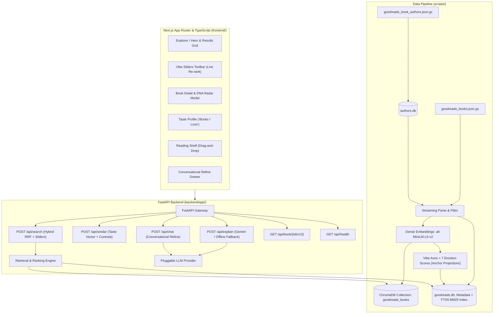

# ShelfSense — LLM-Powered Semantic Book Recommender

> Describe what you want to read in plain English (*"a slow, melancholic novel about leaving home, nothing too long"*) and discover ranked, explainable literary recommendations.

ShelfSense is a modern, editorial semantic book discovery application built on the UCSD Goodreads Book Graph (2.36M books, indexed in full or as a subset). It features hybrid dense-sparse retrieval (Dense Embeddings + BM25 with Reciprocal Rank Fusion), continuous multidimensional **Vibe Sliders**, 9-dimensional **Book DNA** radar charts with side-by-side comparison, a persistent **Reading Shelf**, and a conversational **Refine with AI** librarian drawer.

---

## Architecture Overview



---

## Quickstart

### 1. Clone & Setup Environment
```bash
git clone https://github.com/Tejassveer08/Shelfsense-AI.git
cd Shelfsense-AI
cp .env.example .env
```
*(Optional: add your Gemini API key to `.env` for LLM-written explanations; `.env.example` lists the variable name. Without a key, the app uses the offline fallback.)*

### 2. Install Backend Dependencies
```bash
py -3.11 -m pip install -r requirements.txt
```
*(On macOS/Linux, use `python3.11` instead of `py -3.11`.)*

### 3. Download the Data
ShelfSense uses the [UCSD Book Graph](https://mcauleylab.ucsd.edu/public_datasets/gdrive/goodreads/UCSD%20Book%20Graph.html) Goodreads data. Download these two files from the dataset page into a `data/` folder in the project root:

- [`goodreads_books.json.gz`](https://mcauleylab.ucsd.edu/public_datasets/gdrive/goodreads/goodreads_books.json.gz): book metadata (2.36M books)
- `goodreads_book_authors.json.gz`: author names (linked under "Author information" on the dataset page)

> The data is for academic use only and may not be redistributed or used commercially. See [Data Sources & Citation](#data-sources--citation).

### 4. Build the Search Index
First build the author lookup, then stream the books into the index:

```bash
py -3.11 scripts/build_authors_db.py --gz-path data/goodreads_book_authors.json.gz
py -3.11 scripts/stream_goodreads_index.py --gz-path data/goodreads_books.json.gz --min-ratings 100
```

`stream_goodreads_index.py` reads the file line by line, so memory use stays low. For each book it embeds the text with `all-MiniLM-L6-v2`, computes the vibe and emotion scores, and writes to a SQLite database with FTS5 full-text search (`data/goodreads.db`) and a ChromaDB collection (`data/chroma_db/`, collection `goodreads_books`).

| Option | Default | Purpose |
|---|---|---|
| `--gz-path` | none (always pass it) | Path to `goodreads_books.json.gz` |
| `--max-books` | all | Stop after this many books are indexed |
| `--min-ratings` | `0` | Skip books with fewer ratings than this |
| `--min-words` | `20` | Skip books whose description is shorter than this |
| `--batch-size` | `128` | Books embedded per batch |

- **Start with a subset.** Indexing all 2.36M books takes a long time and a lot of disk space. `--min-ratings 100` keeps the better-known books; add `--max-books 5000` for a quick test.
- **It is resumable.** If you interrupt the script, run the same command again and it skips books that are already indexed. Live progress is written to `data/ingestion_status.json`.
- **Stop the backend while indexing,** then restart it afterwards. ChromaDB's local store is not designed for several processes using it at once.
- **GPU tip:** with an NVIDIA GPU, install a CUDA build of PyTorch from [pytorch.org](https://pytorch.org) to speed up indexing considerably.
- If `data/authors.db` is missing, the script still runs but shows authors as "Author &lt;id&gt;".

### 5. Start Backend Server
```bash
py -3.11 -m uvicorn backend.app.main:app --host 127.0.0.1 --port 8000
```
On startup the console should report the number of books loaded from `goodreads.db` and from the `goodreads_books` Chroma collection. If search returns no results, check these two lines first. The first search after startup is slow while models and the database warm up.

### 6. Install Frontend Dependencies & Start App
```bash
cd frontend
npm install
npm run dev
```

Visit **http://localhost:3000** to explore the library!

### Optional: Run the Backend with Docker
The backend has a `Dockerfile` (CPU-only PyTorch). Build it from the **repository root**, because the image copies `backend/` and `scripts/`:

```bash
docker build -f backend/Dockerfile -t shelfsense-backend .
```

Run it with your `.env` and the `data/` folder mounted. The data is deliberately **not baked into the image**; build the index first (step 4).

```bash
# macOS / Linux
docker run --rm -p 8000:8000 --env-file .env -v "$(pwd)/data:/app/data" shelfsense-backend

# Windows PowerShell
docker run --rm -p 8000:8000 --env-file .env -v "${PWD}/data:/app/data" shelfsense-backend
```

The API is then available at http://localhost:8000 (health check: http://localhost:8000/api/health). The frontend still runs separately with `npm run dev`.

### Running Tests
The retrieval tests use a tiny synthetic database and fake models, so they need neither the index nor an API key:

```bash
py -3.11 -m pytest backend/tests/test_retrieval_goodreads.py
```
*(The first run is slow while PyTorch and the other libraries load.)*

---

## Data & Generated Files

Everything under `data/` is downloaded or generated locally and **none of it is committed to Git**:

| File | Created by | Contents |
|---|---|---|
| `goodreads_books.json.gz`, `goodreads_book_authors.json.gz` | you (download) | Raw Goodreads data |
| `authors.db` | `build_authors_db.py` | Author id to name lookup |
| `goodreads.db` | `stream_goodreads_index.py` | Book metadata, vibe/emotion scores, FTS5 keyword index |
| `chroma_db/` | `stream_goodreads_index.py` | ChromaDB vector store (collection `goodreads_books`) |
| `ingestion_status.json` | `stream_goodreads_index.py` | Live indexing progress |

Two reasons to keep them out of the repo:

1. **Size.** `goodreads.db` and the ChromaDB files are far over GitHub's 100 MB per-file limit.
2. **Licence.** The Goodreads data was collected for academic use only and may not be redistributed or used commercially (see the [dataset page](https://mcauleylab.ucsd.edu/public_datasets/gdrive/goodreads/UCSD%20Book%20Graph.html)). The databases contain book descriptions from it.

Add this to `.gitignore`:

```gitignore
data/*
!data/.gitkeep
```

**Rebuilding the index.** If you change the embedding model, the filters or the scoring logic, delete the generated files in `data/` (keep the downloaded `.json.gz` files) and run the build scripts again. The model that encodes search queries at runtime must be the same one used to build the index (`sentence-transformers/all-MiniLM-L6-v2`), otherwise rankings will be meaningless.

---

## How the Ranking Works

ShelfSense implements a multi-stage hybrid ranking and re-ranking architecture designed to optimize both semantic intent and reader preference:

### 1. Dense Semantic Retrieval
Each book is indexed as one text built from its title, authors, top genres (Goodreads shelves) and the first 350 characters of its description. The user's natural language inquiry is encoded into a 384-dimensional normalized vector using `sentence-transformers/all-MiniLM-L6-v2`. ChromaDB computes cosine distances across all indexed books:
$$\text{sim}_{\text{dense}}(q, d) = 1.0 - \text{cosine\_dist}(q, d)$$
The top 120 dense candidates are retained with their ranks $\text{rank}_{\text{dense}}(d)$.

### 2. Lexical Keyword Matching (BM25)
Concurrently, the query is tokenized (common words such as "the" and "novel" are dropped) and scored with SQLite FTS5's BM25 ranking, using Porter stemming over book titles, authors and descriptions. The top 120 lexical matches are retained with their ranks $\text{rank}_{\text{bm25}}(d)$.

### 3. Reciprocal Rank Fusion (RRF)
To prevent scale variance between vector cosine similarity and unbounded BM25 scores, candidates are merged using Reciprocal Rank Fusion:
$$\text{RRF Score}(d) = \frac{0.60}{60 + \text{rank}_{\text{dense}}(d)} + \frac{0.40}{60 + \text{rank}_{\text{bm25}}(d)}$$
Where $k = 60$ is the standard smoothing constant, and a candidate that appears in only one list is given rank 500 in the other. RRF scores are normalized into $[0, 1]$.

The two retrievers often surface different books: dense search finds books that match the *meaning* of the query, BM25 finds books that contain its *words*. A book that appears in only one list shows a `null` rank for the other in its ranking explanation, which is normal for descriptive queries.

### 4. Hard Filters & Continuous Vibe Slider Re-Ranking
Candidates are first narrowed by any hard filters: category, year range, maximum pages, minimum rating, and tone (the book's score for that emotion must be at least 0.10).

ShelfSense then applies 4 continuous vibe axes in $[-1.0, 1.0]$, computed once when the book is indexed:
- **Dark ↔ Light**: Projection of the book's embedding onto a grim/bleak versus lighthearted/heartwarming anchor axis.
- **Fast-paced ↔ Slow-burn**: Projection onto an action-packed versus contemplative/atmospheric anchor axis.
- **Cerebral ↔ Escapist**: Projection onto a philosophical/demanding versus cozy/easy-read anchor axis.
- **Short ↔ Epic**: Piecewise-linear page count mapping: under 200 pages scores in $[-1.0, -0.2]$, 200–450 pages in $[-0.2, 0.2]$, and over 450 pages in $[0.2, 1.0]$ (capped at 1,000 pages; unknown page counts score 0).

The seven emotion scores (joy, sadness, fear, anger, surprise, disgust, neutral) come from comparing each book's embedding with a descriptive anchor sentence for each emotion.

When the reader adjusts a slider to $S_{\text{axis}}$, an alignment multiplier is applied:
$$\text{alignment}_{\text{axis}} = 1.0 - \frac{|S_{\text{axis}} - B_{\text{axis}}|}{2.0}$$
$$\text{Multiplier} = 1.0 + \sum_{\text{axes}} |S_{\text{axis}}| \times (\text{alignment}_{\text{axis}} - 0.5) \times 0.8$$
$$\text{Final Score}(d) = \text{RRF Score}(d) \times \text{Multiplier}$$
Axes whose slider is within ±0.08 of neutral are ignored, and the multiplier is floored at 0.2.

### 5. Grounded Snippet Highlighting & LLM Explanations
For each candidate, the description is broken into sentences. Sentence-level cosine similarity extracts the exact sentence that best answers the user's inquiry. The pluggable LLM provider (Google Gemini or offline fallback) generates a concise 1–2 sentence explanation grounded strictly in the book's verified text.

---

## Features

| Feature | Description |
|---|---|
| **Natural Language Search** | Debounced search box with rotating animated prompt ideas and example inspiration chips. |
| **Vibe Sliders** | Continuous live re-ranking sliders (Dark ↔ Light, Fast-paced ↔ Slow-burn, Cerebral ↔ Escapist, Short ↔ Epic). |
| **Why this book?** | LLM-generated rationale grounded strictly in book description + highlighted sentence snippet. |
| **Book DNA Radar Chart** | 9-dimensional radar visualization (7 emotions + Pacing + Length) with side-by-side comparison modal. |
| **Taste Profile ("Books I Love")** | Select 1–5 books, adjust star ratings, and synthesize composite taste vectors with attribution. |
| **Contrast Mode** | "Like this book, but..." vector arithmetic ($v_{\text{book}} + \alpha \cdot v_{\text{modifier}}$). |
| **Reading Shelf** | Want to Read / Reading / Finished board with localStorage persistence, drag-and-drop, and shelf-based recommendations. |
| **Conversational Refine** | Chat drawer with stateful AI librarian that updates query, filters, sliders, and results in place. |
| **Explainable Ranking** | "How was this ranked?" popovers detailing dense rank, BM25 rank, RRF score, and vibe adjustments. |
| **Editorial Modern Library UI** | Warm paper & deep ink palette, typography pairing (Newsreader serif + Plus Jakarta Sans), 3D cover tilt, dark mode toggle. |

---

## Known Limitations

- **Discovery Galaxy:** the 2D UMAP map needs a projection of every book, which the Goodreads indexer does not compute yet, so the Galaxy view is not supported with this index.
- **Filters:** only the minimum-rating filter is applied inside ChromaDB. The other filters run on the 400 best candidates, so very strict combinations can return few results.
- **Categories:** the UI's categories are mapped from Goodreads shelf names with keyword rules, so a book's category is approximate.
- **Book ids:** many Goodreads books have no ISBN-13. They are identified by their Goodreads book id instead.
- **Data licence:** the Goodreads data is for academic use only (see below).

---

## API Documentation

- `POST /api/search`: Hybrid search with filters and vibe sliders.
- `POST /api/similar`: Taste profile synthesis and contrast mode recommendations.
- `POST /api/explain`: Grounded explanation and matching sentence extraction.
- `POST /api/chat`: Conversational refinement drawer updates.
- `GET /api/book/{isbn13}`: Detailed book metadata and DNA scores.
- `GET /api/galaxy`: 2D scatter coordinates (not supported with the Goodreads index yet).
- `GET /api/health`: Health status and index statistics.

Interactive Swagger documentation is available at **http://localhost:8000/docs**. When trying `POST /api/search` there, replace the placeholder `"string"` values in the example body (they would filter for a category literally named "string"), or leave `category` and `tone` empty.

---

## Data Sources & Citation

**Goodreads data: UCSD Book Graph.** Collected for academic use only; please do not redistribute it or use it commercially. If you use it, cite:

- Mengting Wan, Julian McAuley, "Item Recommendation on Monotonic Behavior Chains", in *RecSys'18*.
- Mengting Wan, Rishabh Misra, Ndapa Nakashole, Julian McAuley, "Fine-Grained Spoiler Detection from Large-Scale Review Corpora", in *ACL'19*.
