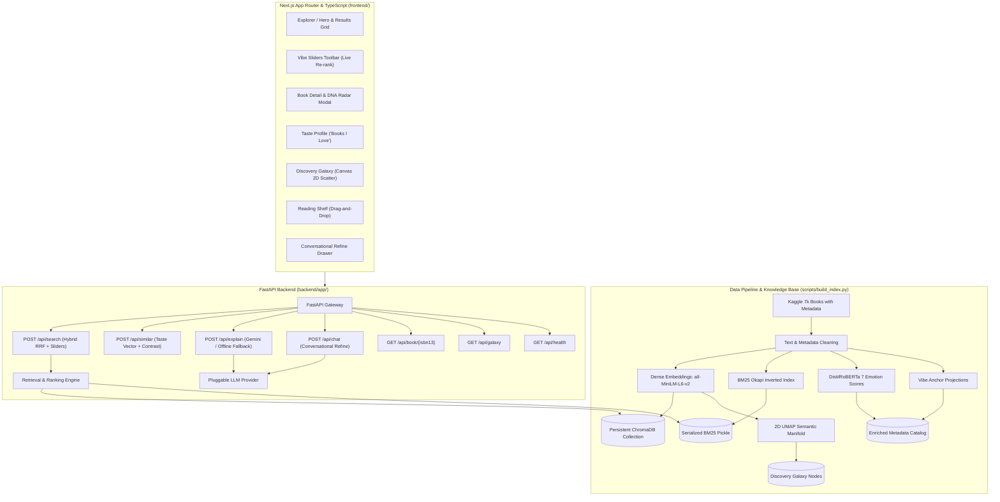

# ShelfSense — LLM-Powered Semantic Book Recommender

> Describe what you want to read in plain English (*"a slow, melancholic novel about leaving home, nothing too long"*) and discover ranked, explainable literary recommendations.

ShelfSense is a modern, editorial semantic book discovery application built on a curated dataset of over 5,200 volumes. It features hybrid dense-sparse retrieval (Dense Embeddings + BM25 with Reciprocal Rank Fusion), continuous multidimensional **Vibe Sliders**, 9-dimensional **Book DNA** radar charts with side-by-side comparison, an interactive 2D UMAP **Discovery Galaxy**, a persistent **Reading Shelf**, and a conversational **Refine with AI** librarian drawer.

---

## Architecture Overview



---

## Quickstart in Under 5 Commands

### 1. Clone & Setup Environment
```bash
git clone https://github.com/your-username/shelfsense.git
cd shelfsense
cp .env.example .env
```

### 2. Install Backend Dependencies & Run Indexing
```bash
py -3.11 -m pip install -r requirements.txt
py -3.11 scripts/build_index.py
```
*(Note: Initial indexing downloads models, cleans 5,230 books, and precomputes emotion scores, embeddings, UMAP coordinates, and BM25 index. Outputs are cached in `data/` for instantaneous subsequent starts).*

### 3. Start Backend Server
```bash
py -3.11 -m uvicorn backend.app.main:app --host 127.0.0.1 --port 8000
```

### 4. Install Frontend Dependencies & Start App
```bash
cd frontend
npm install
npm run dev
```

Visit **http://localhost:3000** to explore the library!

---

## How the Ranking Works

ShelfSense implements a multi-stage hybrid ranking and re-ranking architecture designed to optimize both semantic intent and reader preference:

### 1. Dense Semantic Retrieval
The user's natural language inquiry is encoded into a 384-dimensional normalized vector using `sentence-transformers/all-MiniLM-L6-v2`. ChromaDB computes cosine distances across the 5,230 book document representations:
$$\text{sim}_{\text{dense}}(q, d) = 1.0 - \text{cosine\_dist}(q, d)$$
The top 120 dense candidates are retained with their ranks $\text{rank}_{\text{dense}}(d)$.

### 2. Lexical Keyword Matching (BM25)
Concurrently, the query is tokenized and scored against the BM25 inverted index (`rank_bm25.BM25Okapi`) built from book titles, authors, categories, and descriptions. The top 120 lexical matches are retained with their ranks $\text{rank}_{\text{bm25}}(d)$.

### 3. Reciprocal Rank Fusion (RRF)
To prevent scale variance between vector cosine similarity and unbounded BM25 scores, candidates are merged using Reciprocal Rank Fusion:
$$\text{RRF Score}(d) = \frac{0.60}{60 + \text{rank}_{\text{dense}}(d)} + \frac{0.40}{60 + \text{rank}_{\text{bm25}}(d)}$$
Where $k = 60$ is the standard smoothing constant. RRF scores are normalized into $[0, 1]$.

### 4. Continuous Vibe Slider Re-Ranking
ShelfSense introduces 4 continuous vibe axes in $[-1.0, 1.0]$:
- **Dark ↔ Light**: Derived from emotion valence ($\text{joy} - (\text{sadness} + \text{fear} + \text{anger})$) combined with semantic projection onto light/dark anchor concepts.
- **Fast-paced ↔ Slow-burn**: Derived from narrative pacing anchor projection.
- **Cerebral ↔ Escapist**: Cosine projection onto intellectual literature versus escapist adventure.
- **Short ↔ Epic**: Non-linear page count normalization centered at 320 pages.

When the reader adjusts a slider to $S_{\text{axis}}$, an alignment multiplier is applied:
$$\text{alignment}_{\text{axis}} = 1.0 - \frac{|S_{\text{axis}} - B_{\text{axis}}|}{2.0}$$
$$\text{Multiplier} = 1.0 + \sum_{\text{axes}} |S_{\text{axis}}| \times (\text{alignment}_{\text{axis}} - 0.5) \times 0.8$$
$$\text{Final Score}(d) = \text{RRF Score}(d) \times \text{Multiplier}$$

### 5. Grounded Snippet Highlighting & LLM Explanations
For each candidate, the description is broken into sentences. Sentence-level cosine similarity extracts the exact sentence that best answers the user's inquiry. The pluggable LLM provider (Google Gemini or offline fallback) generates a concise 1–2 sentence explanation grounded strictly in the book's verified text.

---

## Features

| Feature | Description |
|---|---|
| **Natural Language Search** | Debounced search box with rotating animated prompt ideas and example inspiration chips. |
| **Vibe Sliders** | Continuous live re-ranking sliders (Dark ↔ Light, Fast-paced ↔ Slow-burn, Cerebral ↔ Escapist, Short ↔ Epic). |
| **Why this book?** | LLM-generated rationale grounded strictly in book description + highlighted sentence snippet. |
| **Book DNA Radar Chart** | 9-dimensional radar visualization (7 emotions + Pacing + Length) with side-by-side comparison modal. |
| **Taste Profile ("Books I Love")** | Select 1–5 books, adjust star ratings, and synthesize composite taste vectors with attribution. |
| **Contrast Mode** | "Like this book, but..." vector arithmetic ($v_{\text{book}} + \alpha \cdot v_{\text{modifier}}$). |
| **Discovery Galaxy** | 2D UMAP projection rendering all 5,230 books on an interactive, zoomable, genre-colored canvas. |
| **Reading Shelf** | Want to Read / Reading / Finished board with localStorage persistence, drag-and-drop, and shelf-based recommendations. |
| **Conversational Refine** | Chat drawer with stateful AI librarian that updates query, filters, sliders, and results in place. |
| **Explainable Ranking** | "How was this ranked?" popovers detailing dense rank, BM25 rank, RRF score, and vibe adjustments. |
| **Editorial Modern Library UI** | Warm paper & deep ink palette, typography pairing (Newsreader serif + Plus Jakarta Sans), 3D cover tilt, dark mode toggle. |

---

## API Documentation

- `POST /api/search`: Hybrid search with filters and vibe sliders.
- `POST /api/similar`: Taste profile synthesis and contrast mode recommendations.
- `POST /api/explain`: Grounded explanation and matching sentence extraction.
- `POST /api/chat`: Conversational refinement drawer updates.
- `GET /api/book/{isbn13}`: Detailed book metadata and DNA scores.
- `GET /api/galaxy`: Precomputed 2D UMAP scatter coordinates.
- `GET /api/health`: Health status and index statistics.

Interactive Swagger documentation is available at **http://localhost:8000/docs**.
