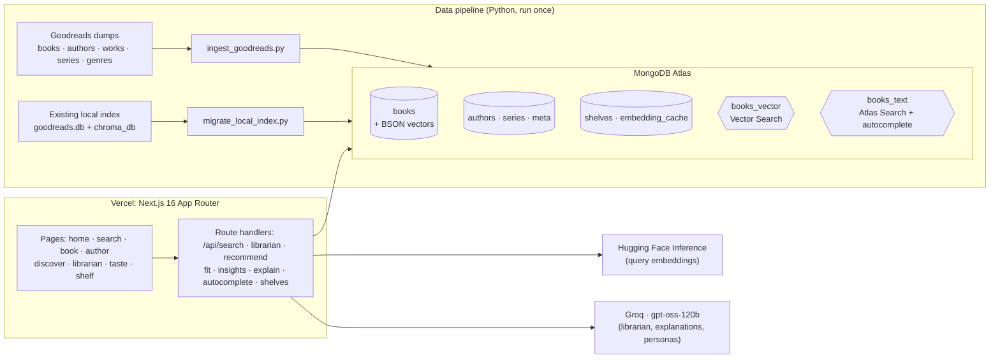

# ShelfSense — AI book discovery on Vercel + MongoDB Atlas

> Describe what you want to read in plain English — *"a slow, melancholic novel about leaving home, nothing too long"*, *"like The Martian but funnier"* — and get ranked, explained recommendations from the Goodreads catalogue.

ShelfSense is a Next.js app that runs on **Vercel**, with the full **UCSD Goodreads Book Graph** in **MongoDB Atlas**. Search is hybrid: Atlas Vector Search handles meaning and Atlas Search (BM25) handles exact words. The two are fused with Reciprocal Rank Fusion and re-ranked by vibe sliders and a reader-love prior. On top of that sit an AI librarian, taste matching, a personal fit score for every book, and a reading-DNA profile of your shelf.

## Features

| | |
|---|---|
| **Natural-language search** | Understands constraints in plain English (*"under 300 pages"*, *"from the 90s"*, *"rated over 4"*, *"sci-fi"*), vibe words (*"dark"*, *"cozy"*, *"fast-paced"*) and negations (*"less dark"*, *"not too long"*), and shows what it understood as chips. |
| **"Like X, but…"** | *"books like Gone Girl but less dark"* searches from that book's own vector, skips its series, sequels and translations, re-ranks by shared Goodreads shelves and applies the modifier. |
| **AI Librarian** | A streaming chat. An LLM on Groq turns the conversation into a search, retrieves real catalogue books, then recommends and explains them grounded in their descriptions. You refine it by talking ("shorter", "more like the second one"). |
| **Taste Match** | Pick books you loved (star-weighted) and books that weren't for you. A taste vector finds their nearest relatives. Free-text modifiers bend it: *"like these, but set in space"*. |
| **Your match** | Every book page scores the book (0-100) against your shelf and says why, naming the closest books you loved. |
| **Reading DNA** | Analyses your shelf: emotional fingerprint, vibe, top categories and genres, eras, and an AI-written reader persona with suggested searches. |
| **Goodreads import** | Upload your Goodreads library export (CSV). Books are matched by Goodreads id, then ISBN, then title and author, keeping your ratings and shelves. |
| **Shareable shelves** | Publish a read-only snapshot of your shelf at `/s/<id>`. Friends can add all of it to their own shelf. |
| **Book pages** | Book DNA radar (compare with any other book), vibe bars, series, more by the author, and "if you like this, try…" neighbours. |
| **Discover** | 12 mood collections, 14 categories, most read, top rated (Bayesian), hidden gems and "surprise me". |
| **Explainable ranking** | "How was this ranked?" shows the vector rank, BM25 rank, RRF score, vibe multiplier, reader-love prior and shared-shelf overlap. |
| **Works without keys** | With no Groq key, every AI feature falls back to a deterministic, grounded offline version. |

## Architecture



```
app/                 pages + API route handlers (Next.js App Router)
components/          UI components
lib/server/          MongoDB, embeddings, hybrid search, recommendations, LLM (server-only)
lib/                 shared types, constants, client API, local shelf store
scripts/             Python data pipeline → MongoDB
docker-compose.yml   local MongoDB with Atlas Search + Vector Search
```

## Quickstart (local)

**Requirements:** Node 20.9+, Python 3.10+ and Docker. You can use an Atlas cluster instead of Docker.

```bash
npm install
cp .env.example .env.local
docker compose up -d mongo        # MongoDB + Atlas Search/Vector Search on :27017
```

Load books into MongoDB (see [Loading the catalogue](#loading-the-catalogue)), then:

```bash
npm run dev                        # http://localhost:3000
```

Check `http://localhost:3000/api/health`. It reports the book count, whether both search indexes are queryable, the embedding provider and the LLM.

## Loading the catalogue

Install the pipeline's dependencies once:

```bash
py -3.11 -m pip install -r requirements.txt     # macOS/Linux: python3 -m pip install -r requirements.txt
```

Both loaders do the same things:

- write identical documents
- create every index (B-tree, Atlas Search and Vector Search)
- build the `authors`, `series` and `meta` collections
- resume safely if interrupted

### Option A: full Goodreads dataset from the raw dumps (recommended)

Download from the [UCSD Book Graph page](https://mcauleylab.ucsd.edu/public_datasets/gdrive/goodreads/UCSD%20Book%20Graph.html) into `data/`:

| File | Needed? | Used for |
|---|---|---|
| `goodreads_books.json.gz` | required | 2.36M editions: titles, descriptions, shelves, ratings |
| `goodreads_book_authors.json.gz` | strongly recommended | author names |
| `goodreads_book_works.json.gz` | recommended | one edition per work, work-level ratings, original year |
| `goodreads_book_series.json.gz` | optional | series names and reading order |
| `goodreads_book_genres_initial.json.gz` | optional | better categories |

```bash
py -3.11 scripts/ingest_goodreads.py --books data/goodreads_books.json.gz \
  --authors data/goodreads_book_authors.json.gz --works data/goodreads_book_works.json.gz \
  --series data/goodreads_book_series.json.gz --genres data/goodreads_book_genres_initial.json.gz
```

The script makes two passes over the books file:

1. It picks the most-rated edition of each work that has a description of at least 20 words. It keeps English and unknown-language editions; `--all-languages` keeps the rest.
2. It embeds each chosen book with `all-MiniLM-L6-v2`, scores its vibes and emotions, and upserts it.

Add `--limit 2000` for a smoke test. A CUDA build of PyTorch makes embedding 10–20× faster.

### Option B: reuse an existing local index (fast)

If you built `data/goodreads.db` and `data/chroma_db` with the previous version of ShelfSense, copy them over without re-embedding:

```bash
py -3.11 scripts/migrate_local_index.py
```

This loaded **488,446 books in 5.5 minutes** in testing; 90,882 duplicate editions were collapsed. The old indexer stopped after scanning about 724K of the 2.36M editions, so some famous books are missing from that index (the main *Dune* edition, for example). Use option A for the complete catalogue.

### Sizing and Atlas tiers

Measured with float32 vectors and descriptions capped at 2,000 characters: **about 3.1 KB per book** (1.36 GB of storage for 488K books). int8 vectors (`--vector-format int8`) store each vector in 384 bytes instead of 1,536.

| Atlas tier | Storage | Suggested load |
|---|---|---|
| M0 (free) | 512 MB | `--preset free`: the 150K most-rated books, int8 vectors, 700-character descriptions. Set `VECTOR_FORMAT=int8`. |
| Flex | 5 GB | everything, float32 (the default) |
| M10+ | 10 GB+ | everything, plus headroom for vector search memory |

`VECTOR_FORMAT` in the app must match the `--vector-format` you loaded with.

## Deploying to Vercel

1. **Atlas:** create a cluster, a database user, and allow network access from Vercel. `0.0.0.0/0`, or the Vercel ↔ Atlas integration, which also sets `MONGODB_URI` for you.
2. **Load the data** from your machine with `MONGODB_URI` pointing at Atlas (see above). Wait until `scripts/setup_indexes.py` reports that both search indexes are queryable.
3. **Import the repo** in Vercel. It is a standard Next.js project at the repository root, so no build settings are needed.
4. **Environment variables** (Project → Settings → Environment Variables):

| Variable | Required | Notes |
|---|---|---|
| `MONGODB_URI` | yes | Atlas connection string |
| `MONGODB_DB` | no | default `shelfsense` |
| `VECTOR_FORMAT` | no | `float32` (default) or `int8`, matching the load |
| `HF_TOKEN` | recommended | free [Hugging Face token](https://huggingface.co/settings/tokens) (fine-grained, with *Make calls to Inference Providers*) for query embeddings. Without it, Vercel falls back to keyword-only search. |
| `EMBEDDINGS_PROVIDER` | no | `auto` (default), `hf`, `local` or `none` |
| `GROQ_API_KEY` | optional | free [Groq key](https://console.groq.com/keys); enables the AI librarian, explanations, fit verdicts and personas. Without it they use offline fallbacks. |
| `GROQ_MODEL` | no | default `openai/gpt-oss-120b` (`openai/gpt-oss-20b` is faster) |

### Getting the two free keys

- **`HF_TOKEN`:** sign in at [huggingface.co](https://huggingface.co), open **Settings → Access Tokens** ([direct link](https://huggingface.co/settings/tokens)), click **Create new token**, choose **Fine-grained**, tick **Make calls to Inference Providers**, and create it. The token starts with `hf_`. Free accounts get a small monthly inference allowance; one search is one tiny embedding call, and repeats are cached.
- **`GROQ_API_KEY`:** sign in at [console.groq.com](https://console.groq.com) (no card needed), open **API Keys** ([direct link](https://console.groq.com/keys)), click **Create API Key**, and copy it right away (it starts with `gsk_` and is shown once). The free tier is rate-limited per minute and per day; when a limit is hit, the app quietly uses its offline answers.

Put both in `.env.local` for local development and in Vercel's environment variables for production. Never commit them.

**Why Hugging Face for query embeddings?** The catalogue was embedded with `sentence-transformers/all-MiniLM-L6-v2`, so queries must use the same model. Locally it runs inside Node through `@huggingface/transformers`. Its ONNX runtime is about 290 MB, which is too large for a Vercel function, so on Vercel the same model is called through the Hugging Face Inference API. Query vectors are cached in MongoDB (`embedding_cache`, 30-day TTL), so repeat searches skip the call.

## How ranking works

1. **Query understanding** (`lib/server/intent.ts`): pulls hard filters, vibe sliders and negations out of the text. *"like X"* is resolved to a catalogue book.
2. **Retrieval:** both run in parallel with the same pre-filters:
   - `$vectorSearch` returns the top 150 by cosine similarity to the query (or to the anchor book plus the modifier).
   - `$search` returns the top 150 by BM25 over title, authors, shelves and description, with vibe adjectives removed from the keywords.
3. **Fusion:** `RRF = 0.6 / (60 + rank_vector) + 0.4 / (60 + rank_text)`, normalised to [0, 1].
4. **Re-ranking:** the RRF score is multiplied by four factors:
   - **Vibe alignment**, per slider: `1 + Σ |s| · (alignment − 0.5) · 0.8`.
   - **Reader-love prior:** `(0.62 + 0.38 · log-readership) × (0.92 + 0.08 · Bayesian rating)`. Box sets are discounted to ×0.75 and study guides to ×0.4.
   - **Shelf overlap** with the anchor book (for "like X" searches).
   - **Title-echo penalty**, so *"space opera with found family"* isn't won by a book titled *Space Opera*.

   Exact title matches and author-name queries are boosted.
5. **Grounding:** the description sentence closest to the query is highlighted. LLM explanations may only use the book's own text.

Every factor is shown in the "How was this ranked?" popover.

## API

| Method | Route | Purpose |
|---|---|---|
| `POST` | `/api/search` | `{query, filters?, sliders?, limit?, excludeIds?}` → hybrid results and the parsed intent |
| `POST` | `/api/librarian` | `{messages, previous?, shownIds?, readIds?}` → NDJSON stream of `plan`, `books`, `text` and `done` events |
| `POST` | `/api/recommend` | `{loved:[{id,rating}], disliked?, modifier?, exclude?}` → taste-profile or contrast results |
| `POST` | `/api/fit` | `{id, loved, disliked?}` → personal match score and verdict |
| `POST` | `/api/insights` | `{books:[{id,rating}]}` → reading DNA and persona |
| `POST` | `/api/explain` | `{id, query, snippet?}` → grounded "why this book" |
| `GET` | `/api/books/:id` · `/api/books/:id/similar` | book details · nearest neighbours |
| `POST` | `/api/books/lookup` | resolve Goodreads export rows to catalogue books |
| `GET` | `/api/autocomplete?q=` | title and author typeahead |
| `GET` | `/api/browse?kind=popular\|top\|gems&category=` | browse lists |
| `GET` | `/api/surprise` | a random well-loved book |
| `POST`/`GET` | `/api/shelves` · `/api/shelves/:id` | publish or read a shared shelf |
| `GET` | `/api/health` | database, index, embedding and LLM status |

## Known limitations

- **Small embedding model.** `all-MiniLM-L6-v2` is fast and cheap, but for short descriptive queries it sometimes favours books whose titles share the query's words. The ranking counteracts this but doesn't remove it. An A/B test on 30K books found that embedding descriptions first, instead of titles first, did not help, so the bigger win would be a stronger embedding model. That means re-embedding the catalogue and using the same model for queries.
- **Data age and licence.** The UCSD dump was scraped in 2017 and is for academic, non-commercial use only. Don't redistribute it. Cite: Mengting Wan, Julian McAuley, *"Item Recommendation on Monotonic Behavior Chains"*, RecSys 2018, and Mengting Wan, Rishabh Misra, Ndapa Nakashole, Julian McAuley, *"Fine-Grained Spoiler Detection from Large-Scale Review Corpora"*, ACL 2019.
- **The shelf lives in the browser.** It is stored in `localStorage`, with no accounts. Use Share to publish a snapshot, and import a Goodreads CSV to restore it elsewhere.
